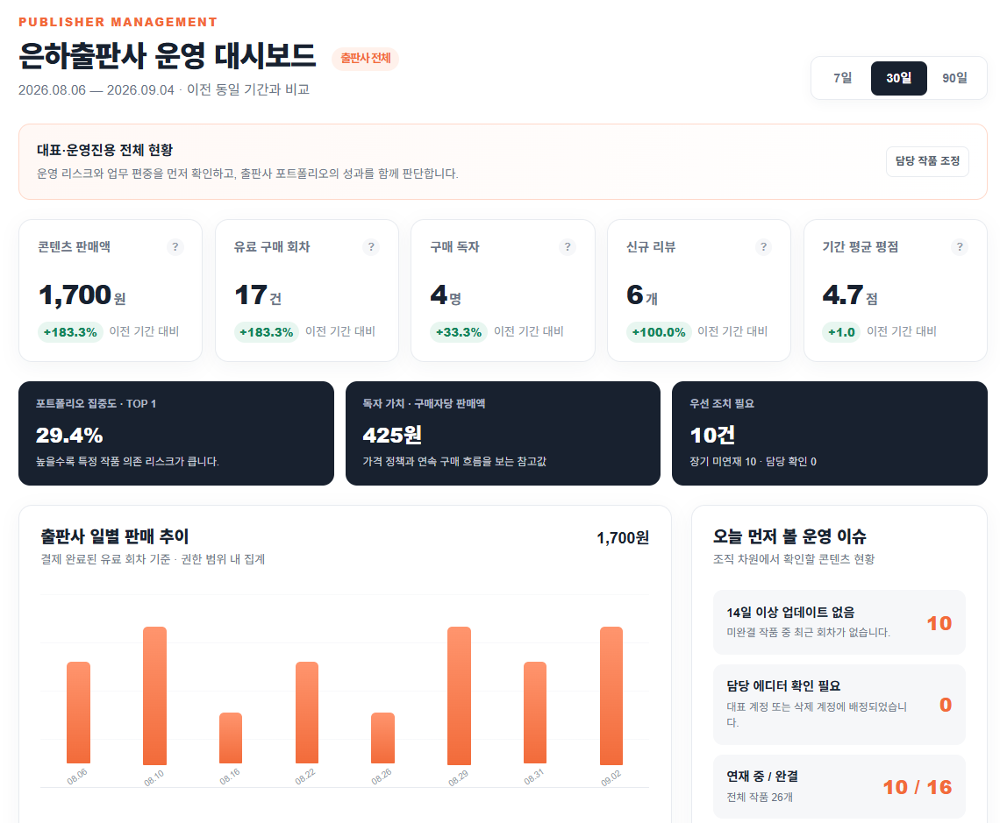
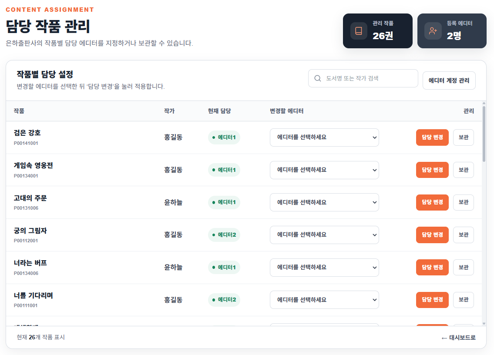
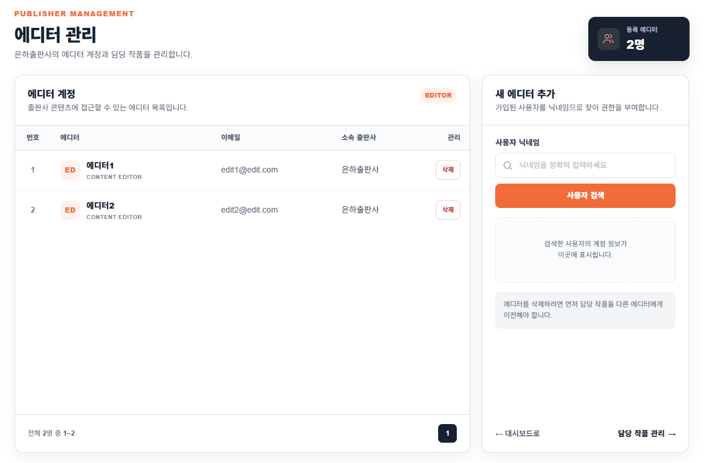
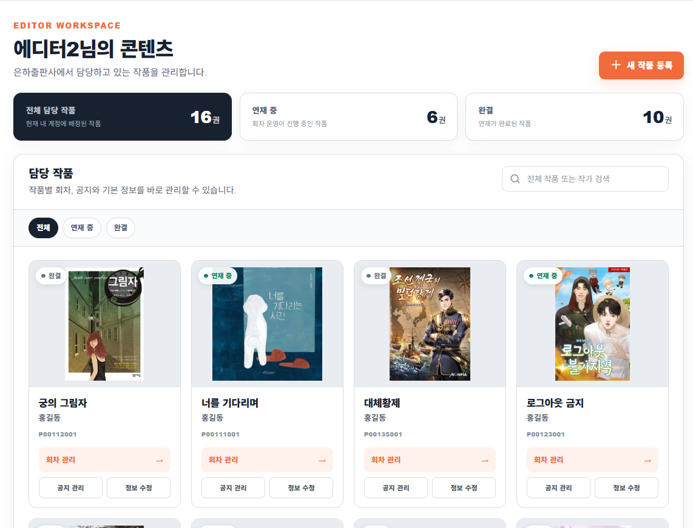

# KiHiBooks

여러 출판사가 함께 쓰는 웹소설 플랫폼입니다. 출판사가 작품을 등록·연재하고 독자가 회차를 구매·열람합니다. 출판사 대표(운영자)는 소속 에디터와 담당 작품을 관리하고, 에디터는 자기가 맡은 작품만 다룹니다.

- **개발 형태:** 3인 팀 프로젝트 (2025.04 ~ 2025.06)
- **내 담당:** 출판사·에디터 API 27개, 관리자 API 5개 전부 / 역할·소속·담당 기반 접근 제어 / 출판사 KPI 대시보드
- **담당 기능:** 출판사 계정·에디터 관리, 도서·회차·공지 등록과 수정, 출판사 KPI 대시보드, 개인 서재, 인증·보안 설정
- **결제·포인트·무료 주문**은 팀원 담당입니다.

## 핵심 문제: 역할만 보면 남의 도서를 고칠 수 있었다

출판사 계정은 모두 같은 `PUBLISHER` 역할이었습니다. 역할만 확인하면 주소의 도서 코드만 바꿔 다른 출판사, 다른 에디터의 도서 수정 화면에 들어갈 수 있었습니다.

그래서 요청마다 세 가지를 차례로 확인합니다.

| 단계 | 확인하는 것 | 구현 위치 |
| --- | --- | --- |
| 1. 역할 | 관리자 / 운영자(`SUPER`) / 에디터(`EDITOR`) / 사용자 | Spring Security URL 규칙 (`SecurityConfig`) |
| 2. 소속 | 요청한 도서·회차·공지가 내 출판사 것인가 | `PublisherInterceptor` + `@PreAuthorize` |
| 3. 담당 | 에디터라면 내가 담당하는 도서인가 (운영자는 출판사 전체) | `PublisherInterceptor` + `@PreAuthorize` |

인증 정보(`CustomUser`)에 출판사 코드(`pu_code`)와 출판사 계정 식별자(`pi_num`)를 담아, 2·3단계를 DB 재조회 없이 비교합니다.

### 왜 두 겹으로 막았나

| 방법 | 판단 |
| --- | --- |
| 컨트롤러마다 직접 검사 | 출판사·에디터 API가 27개. 하나라도 빠뜨리면 그대로 구멍 |
| 인터셉터만 | 등록한 경로만 지킴. 같은 메서드가 다른 경로로 호출되면 통과 |
| **인터셉터 + 메서드 보안** | `/publisher/**`, `/editor/**` 전체는 인터셉터로, 도서 관리 메서드는 `@PreAuthorize("@ss.canAccessBook(#bo_code)")`로 한 번 더. 규칙은 `SecurityService` 한 클래스에 모아 둘이 같은 판단을 함 |

```java
// SecurityService.java — 인터셉터와 메서드 보안이 함께 쓰는 규칙
public boolean canAccessBook(CustomUser user, BookVO book) {
    if (user == null || book == null || user.getPu_code() == null
            || !user.getPu_code().equals(book.getBo_pu_code())) {
        return false;                                   // 다른 출판사 도서
    }
    return "SUPER".equals(user.getAuthority())          // 운영자: 출판사 전체
            || book.getBo_pi_num() == user.getPi_num(); // 에디터: 담당 도서만
}
```

### 찾아서 고친 문제

- **꺼져 있던 구매 검증** — 구매한 회차만 읽게 하는 검증이 꺼져 있었습니다. 유료 구매는 `buy_list`에만 기록되는데 검증은 `library`만 확인해서 결제한 독자까지 차단됐기 때문입니다. 두 테이블을 모두 확인하도록 고치고 검증을 다시 켰습니다. (`a5192d2`)
- **다른 출판사 에디터 등록·해제·배정** (`8f96f0a`)
  - 에디터 등록: 출판사 코드를 요청 값 대신 로그인한 대표의 소속에서 가져오고, 이미 다른 출판사에 소속된 사용자는 거절
  - 에디터 해제: 우리 출판사 소속일 때만 허용
  - 담당 에디터 변경: 새 담당자가 도서와 같은 출판사일 때만 SQL이 반영
- **EPUB 폴더 이름 우회** — Windows는 경로 대소문자를 구분하지 않아 `EPUBS`처럼 요청하면 권한 검사를 건너뛰었습니다. 파일 응답은 `covers`, `epubs` 폴더만 허용하도록 바꿨습니다. (`8f96f0a`)

## 테스트

막아야 하는 접근을 테스트로 고정했습니다. 2026-11-10 `mvnw test` 기준 **32개 전부 통과**.

| 테스트 클래스 | 개수 | 검증 내용 |
| --- | ---: | --- |
| `PublisherInterceptorTest` | 9 | 경로 단위 소속·담당 검사, 403 응답 |
| `SecurityServiceTest` | 11 | 소유권·구매 규칙 |
| `PublisherMethodSecurityTest` | 3 | 인터셉터를 거치지 않는 메서드 직접 호출 |
| `PublisherServiceEditorTest` | 5 | 다른 출판사 에디터 등록·해제·배정 차단 |
| `FileControllerTest` | 2 | 허용 폴더 외 파일 요청 차단 |
| `PublisherDashboardTest` | 2 | 역할별 대시보드 조회 |

주요 시나리오:

| 상황 | 결과 |
| --- | --- |
| 운영자가 자기 출판사의 다른 에디터 도서 접근 | 허용 |
| 운영자가 다른 출판사 도서 접근 | 403 |
| 에디터가 다른 에디터 담당 도서 접근 | 403 |
| 에디터가 요청 파라미터로 남의 도서 코드를 넣어 완결 처리 | 403 |
| 구매하지 않은 독자가 회차 본문 열람 | 403 |
| 유료 구매한 독자가 회차 본문 열람 | 허용 |
| 담당 에디터가 구매 없이 자기 회차 열람 | 허용 |
| 인터셉터를 거치지 않고 메서드를 직접 호출 (담당 아님) | 403 |

## 주요 화면

화면의 작품·계정·실적은 샘플 데이터입니다.

<table>
  <tr>
    <td width="50%"><b>출판사 운영 대시보드 (대표)</b><br>전체 실적을 직전 같은 기간과 비교하고 운영 이슈를 확인</td>
    <td width="50%"><b>담당 작품 관리 (대표)</b><br>작품별 담당 에디터 지정. 같은 출판사 소속일 때만 반영</td>
  </tr>
  <tr>
    <td></td>
    <td></td>
  </tr>
  <tr>
    <td><b>에디터 관리 (대표)</b><br>사용자를 찾아 에디터 권한 부여·해제. 다른 출판사 소속은 등록 불가</td>
    <td><b>에디터 콘텐츠 관리 (에디터)</b><br>배정된 작품만 보고 회차·공지·정보 관리</td>
  </tr>
  <tr>
    <td></td>
    <td></td>
  </tr>
  <tr>
    <td><b>독자 홈</b><br>장르별 탐색, 프로모션 배너, 실시간 랭킹</td>
    <td></td>
  </tr>
  <tr>
    <td></td>
    <td></td>
  </tr>
</table>

## 역할별 주요 기능

| 구분 | 기능 |
| --- | --- |
| 독자 | 회원가입·로그인, 카카오 로그인, 장르별 탐색·검색, 작품 상세·회차 열람, 장바구니·구매 내역, 포인트, 리뷰·댓글, 출석 체크 |
| 출판사 대표 | 에디터 등록·해제, 작품별 담당 에디터 지정, 소속 출판사 콘텐츠 관리, 출판사 전체 KPI 조회 |
| 출판사 에디터 | 담당 작품 조회, 도서 정보·회차·가격·작품 공지 관리, 담당 작품 KPI 조회 |
| 서비스 관리자 | 출판사 등록 및 출판사 계정 관리 |

## 그 밖의 구현

### 역할별 KPI 대시보드

`/publisher/dashboard`에서 최근 7일·30일·90일 실적을 직전 같은 기간과 비교합니다. 로그인한 사용자의 출판사 코드와 담당자 식별자로 조회 범위를 정합니다.

| 구분 | 조회 범위 및 지표 |
| --- | --- |
| 공통 | 콘텐츠 판매액, 유료 구매 회차 수, 구매 독자 수, 리뷰 수, 평균 별점, 일별 판매 추이 |
| 대표 | 출판사 전체 실적, 에디터별 현황, 상위 작품 매출 비중, 구매 독자당 판매액 |
| 에디터 | 담당 작품 실적, 최근 회차 등록이 없거나 14일 이상 지난 작품 |

### 여러 테이블 변경의 트랜잭션

에디터 등록·해제는 사용자 권한과 출판사 계정 정보를, 도서 정보 수정은 도서와 키워드 연결을 함께 바꿉니다. 해당 서비스 메서드에 `@Transactional`을 걸어 중간에 예외가 나면 DB 변경을 롤백합니다. 업로드한 파일의 저장·삭제는 롤백 대상이 아닙니다.

## 현재 한계

- 소유권 검증은 `/publisher/**`, `/editor/**` 경로와 `@PreAuthorize`를 붙인 메서드에만 적용됩니다. 같은 데이터를 다루는 새 경로를 만들 때 둘 중 하나를 빠뜨리면 검증에서 빠집니다.
- 파일 저장·삭제는 DB 트랜잭션과 묶이지 않아, 롤백되면 파일이 남거나 사라질 수 있습니다.

## 기술 스택

| 영역 | 기술 |
| --- | --- |
| 언어·서버 | Java 17, Spring Boot 3.4.5, Spring MVC |
| 인증·권한 | Spring Security, BCrypt |
| 데이터 접근 | MyBatis 3.0.3, Spring JDBC |
| 데이터베이스 | MySQL |
| 화면 | Thymeleaf, Thymeleaf Layout Dialect, HTML, CSS, JavaScript, Swiper |
| 외부 연동 | 카카오 로그인, SMTP 메일 |
| 빌드·테스트 | Maven Wrapper, Spring Boot Test, Spring Security Test |

Thymeleaf로 HTML을 렌더링하는 서버 중심 구조입니다. 루트의 `package.json`은 Swiper 의존성만 관리하며, 별도 프런트엔드 실행 스크립트는 없습니다.

## 프로젝트 구조

```text
KiHiBooks/
├── DB/                          # 스키마 및 샘플 데이터 SQL
├── kihibooks/
│   ├── pom.xml
│   ├── mvnw / mvnw.cmd          # Maven Wrapper
│   └── src/
│       ├── main/
│       │   ├── java/kr/kh/kihibooks/
│       │   │   ├── config/      # Security, MyBatis, MVC 설정
│       │   │   ├── controller/  # 요청 처리
│       │   │   ├── service/     # 업무 로직
│       │   │   ├── dao/         # MyBatis Mapper 인터페이스
│       │   │   ├── model/       # 데이터 모델
│       │   │   ├── interceptor/ # 출판사 접근 검증
│       │   │   └── utils/       # 인증·소유권 규칙(SecurityService)
│       │   └── resources/
│       │       ├── mappers/     # SQL 매핑
│       │       ├── templates/   # Thymeleaf 화면
│       │       └── static/      # CSS, JavaScript, 이미지
│       └── test/                # 접근 제어·대시보드 테스트
├── package.json
└── README.md
```

## 로컬 실행

### 1. 준비 사항

- JDK 17 및 `JAVA_HOME` 설정
- 실행 중인 MySQL과 DB 생성 권한이 있는 계정
- 메일·카카오 로그인을 쓰려면 해당 서비스의 연동 값

Maven은 저장소의 Wrapper로 실행합니다.

### 2. 데이터베이스 구성

MySQL Workbench에서 아래 SQL을 순서대로 실행합니다. 스키마는 `KIHIBOOKS`를 선택합니다.

**주의:** `DB/키히북스 DDL.sql`은 기존 `KIHIBOOKS` 데이터베이스를 삭제하고 다시 만듭니다. 새 로컬 개발 DB를 준비할 때만 실행하세요.

| 순서 | 파일 | 내용 |
| --- | --- | --- |
| 1 | `DB/키히북스 DDL.sql` | 데이터베이스·테이블 생성 |
| 2 | `DB/step1_2_3_user_author_cate.sql` | 사용자·출판사·작가·분류 등 기본 데이터 |
| 3 | `DB/step4_books_insert.sql` | 도서 |
| 4 | `DB/step5_insert_reviews.sql` | 리뷰 |
| 5 | `DB/step6_insert_book_keywords.sql` | 도서별 키워드 |
| 6 | `DB/step7_episode_dummy.sql` | 회차 |
| 선택 | `DB/kpi_dashboard_demo.sql` | 실행일 기준 KPI 데모 데이터 |

샘플 SQL의 비밀번호는 평문이라 BCrypt를 쓰는 현재 로그인에 그대로 쓸 수 없습니다. 회원가입으로 만든 계정을 쓰거나 샘플 계정의 `UR_PW`를 BCrypt 해시로 바꾸세요. 출판사 화면을 쓰려면 사용자 권한과 `PUBLISHER_ID` 소속·역할 정보도 필요합니다.

### 3. 로컬 설정

`kihibooks/src/main/resources/application.properties`를 만듭니다. 이 파일은 Git에서 제외됩니다.

```properties
spring.application.name=kihibooks
server.port=8080

kihibooks.datasource.driver-class-name=com.mysql.cj.jdbc.Driver
kihibooks.datasource.jdbc-url=jdbc:mysql://localhost:3306/KIHIBOOKS?useSSL=false&allowPublicKeyRetrieval=true&serverTimezone=Asia/Seoul
kihibooks.datasource.username=YOUR_DB_USERNAME
kihibooks.datasource.password=YOUR_DB_PASSWORD

spring.remember.me.key=REPLACE_WITH_A_RANDOM_LOCAL_SECRET
spring.path.upload=C:/kihibooks/uploads/

spring.mail.host=YOUR_SMTP_HOST
spring.mail.port=587
spring.mail.username=YOUR_SMTP_USERNAME
spring.mail.password=YOUR_SMTP_PASSWORD
spring.mail.properties.mail.smtp.auth=true
spring.mail.properties.mail.smtp.starttls.enable=true

kakao.client.id=YOUR_KAKAO_REST_API_KEY
kakao.redirect.uri=http://localhost:8080/signup/kakao
```

DB 설정은 `spring.datasource.*`가 아니라 **`kihibooks.datasource.*`**입니다. `MyBatisConfig`가 이 접두사로 데이터 소스를 만듭니다.

업로드 디렉터리를 미리 만들고 쓰기 권한을 주세요. SQL에 들어 있는 이미지·EPUB 경로의 실제 파일은 따로 준비해야 하며, 없으면 표지나 본문이 표시되지 않습니다.

### 4. 서버 실행

```powershell
cd kihibooks
.\mvnw.cmd spring-boot:run
```

macOS / Linux에서는 `sh mvnw spring-boot:run`을 사용합니다. 실행 후 http://localhost:8080 에 접속합니다.

| 경로 | 화면 |
| --- | --- |
| `/login` | 로그인 |
| `/genre/romance` | 로맨스 장르 |
| `/publisher/dashboard` | 출판사·에디터 KPI 대시보드 |
| `/publisher/editors` | 대표의 에디터 관리 |
| `/editor/myContent` | 콘텐츠 목록 |
| `/account/mykihi` | 사용자 마이페이지 |

### 5. 테스트 및 빌드

```powershell
cd kihibooks
.\mvnw.cmd test
.\mvnw.cmd package
java -jar target/kihibooks-0.0.1-SNAPSHOT.jar
```

`package`에도 테스트 실행이 포함됩니다.

## KPI 데모 데이터

`DB/kpi_dashboard_demo.sql`은 은하출판사(`P001`)의 기존 도서·회차로 실행일 기준 데이터를 만듭니다.

| 기간 | 콘텐츠 판매액 | 유료 구매 회차 | 구매 독자 | 리뷰 |
| --- | ---: | ---: | ---: | ---: |
| 최근 30일 | 1,700원 | 17건 | 4명 | 6개 |
| 이전 30일 | 600원 | 6건 | 3명 | 3개 |

위 수치는 데모로 추가하는 데이터 기준이며, 기존 데이터가 있으면 합계가 달라집니다.

- 주문 ID는 `KPIDEMO`, 리뷰 내용은 `[KPI_DEMO]`로 구분합니다.
- 다시 실행하면 데모 주문·리뷰를 교체해 중복 생성을 막습니다.
- 필요한 기본 사용자나 `P001` 회차가 없으면 오류를 내고 롤백합니다.
- 최소한 `step1_2_3_user_author_cate.sql`, `step4_books_insert.sql`, `step7_episode_dummy.sql`이 적용되어 있어야 합니다.

```text
mysql -u YOUR_DB_USERNAME -p --default-character-set=utf8mb4 KIHIBOOKS
mysql> source C:/path/to/KiHiBooks/DB/kpi_dashboard_demo.sql;
```
